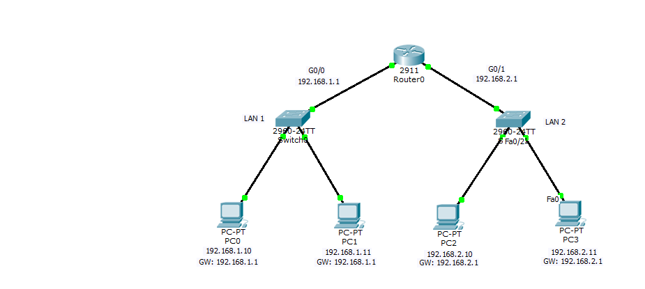

# Two-LAN Network Segmentation Lab (Cisco Packet Tracer)

A beginner-level networking lab that builds a router-on-a-stick-free, dual-interface LAN
segmentation setup using a Cisco 2911 router and two Cisco 2960 switches in Packet Tracer.
This project demonstrates basic inter-VLAN/inter-LAN routing between two separate physical
LAN segments using two router interfaces, each acting as the default gateway for its own subnet.

## 📌 Project Objective

Configure a router with two separate LAN segments (192.168.1.0/24 and 192.168.2.0/24), verify
IP connectivity between hosts on different LANs through the router, and document the full
configuration and verification process.

## 🖧 Topology



| Device | Interface | IP Address | Subnet Mask |
|---|---|---|---|
| Router0 (Cisco 2911) | G0/0 | 192.168.1.1 | 255.255.255.0 |
| Router0 (Cisco 2911) | G0/1 | 192.168.2.1 | 255.255.255.0 |
| Switch0 (2960-24TT) | — | LAN 1 access switch | — |
| Switch0 8 (2960-24TT) | — | LAN 2 access switch | — |

| Host | IP Address | Default Gateway | Connected To |
|---|---|---|---|
| PC0 | 192.168.1.10 | 192.168.1.1 | Switch0 (LAN 1) |
| PC1 | 192.168.1.11 | 192.168.1.1 | Switch0 (LAN 1) |
| PC2 | 192.168.2.10 | 192.168.2.1 | Switch0 8 (LAN 2) |
| PC3 | 192.168.2.11 | 192.168.2.1 | Switch0 8 (LAN 2) |

## ⚙️ Router Configuration

The router is configured with two active Gigabit Ethernet interfaces, one per LAN, each
serving as the default gateway for its subnet. A third interface (G0/2) is left unused and
shut down. See the full config: [`configs/router-config.txt`](configs/router-config.txt)

```
interface GigabitEthernet0/0
 ip address 192.168.1.1 255.255.255.0
 duplex auto
 speed auto
!
interface GigabitEthernet0/1
 ip address 192.168.2.1 255.255.255.0
 duplex auto
 speed auto
!
interface GigabitEthernet0/2
 no ip address
 duplex auto
 speed auto
 shutdown
!
interface Vlan1
 no ip address
 shutdown
```

**Key config notes:**
- No routing protocol is needed here — since both networks are *directly connected* to the
  router, it automatically knows how to route between them.
- `ip flow-export version 9` is enabled for traffic flow monitoring.
- G0/2 and the switch management VLAN (Vlan1) are intentionally left unused/shutdown since
  they aren't needed for this lab.

## ✅ Verification

Full raw output: [`verification/verification.txt`](verification/verification.txt)

### Routing Table (`show ip route`)
Both LANs show up as directly connected (`C`) and local (`L`) routes — confirming the router
is aware of both subnets and ready to route between them without any static routes or a
routing protocol.

```
C    192.168.1.0/24 is directly connected, GigabitEthernet0/0
L    192.168.1.1/32 is directly connected, GigabitEthernet0/0
C    192.168.2.0/24 is directly connected, GigabitEthernet0/1
L    192.168.2.1/32 is directly connected, GigabitEthernet0/1
```

### ARP Table (`show arp`)
The ARP table confirms the router has successfully resolved MAC addresses for hosts on
**both** LAN segments, proving that Layer 2 connectivity and Layer 3 addressing are both
working correctly on each interface.

```
Internet  192.168.1.10   0   0003.E427.2328  ARPA   GigabitEthernet0/0
Internet  192.168.2.10   0   000D.BDDA.0842  ARPA   GigabitEthernet0/1
Internet  192.168.2.11   0   0002.17B9.362B  ARPA   GigabitEthernet0/1
```

### Live Demo
A screen recording of the lab in action (ping tests / connectivity walkthrough) is included
here: [`demo/demo-recording.mp4`](demo/demo-recording.mp4)

## 📂 Repository Structure

```
LAN-Segmentation-Lab/
├── README.md                              # This file
├── topology/
│   └── topology.png                       # Network diagram
├── configs/
│   └── router-config.txt                  # Router running-config
├── verification/
│   └── verification.txt                   # show ip route / show arp output
├── packet-tracer-file/
│   └── Lan_Network_Configuration.pkt      # Open in Cisco Packet Tracer
└── demo/
    └── demo-recording.mp4                 # Screen recording of the working lab
```

## 🧠 What This Lab Demonstrates

- Basic router interface configuration (IP addressing on Gigabit Ethernet interfaces)
- How a router connects and routes between two separate LAN segments without a routing
  protocol (directly connected networks)
- Reading and interpreting `show ip route` and `show arp` output
- End-to-end verification of a small routed network

## 🛠️ Tools Used

- Cisco Packet Tracer
- Cisco IOS CLI

## 🚀 How to Open This Lab

1. Install [Cisco Packet Tracer](https://www.netacad.com/courses/packet-tracer) (free with a
   Cisco NetAcad account).
2. Open `packet-tracer-file/Lan_Network_Configuration.pkt`.
3. Click on Router0 → CLI tab to view/modify the configuration.
4. Use the Command Prompt on any PC (or the Simple PDU tool) to test `ping` between hosts on
   different LANs, e.g. ping `192.168.2.10` from PC0.

## 👤 Author

Anish Raj — Aspiring Network Engineer, currently building CCNA / networking fundamentals skills.

---
*This lab is part of my ongoing CCNA / Network Administrator study roadmap.*
