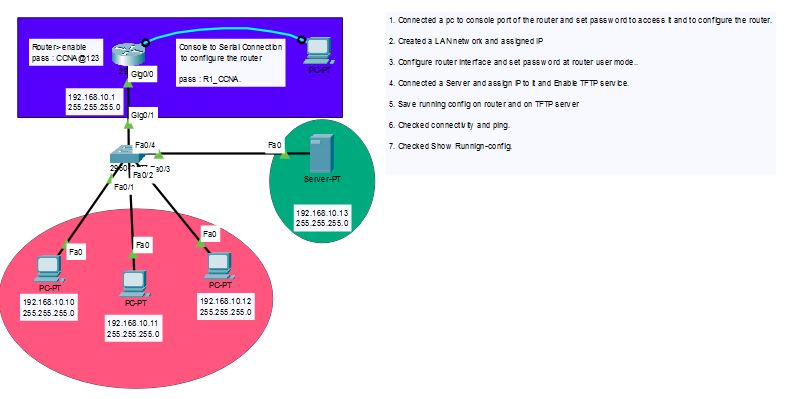

# Router Password Security & TFTP Config Backup Lab (Cisco Packet Tracer)

A beginner-level lab that secures a Cisco router with console and privileged-mode passwords,
encrypts those passwords in the config, assigns an IP address to the LAN interface, and backs up
the running configuration to a TFTP server.

## 📌 Project Objective

Configure basic router security (hostname, console password, enable secret, password encryption),
build a small LAN with a switch, three PCs and a server, and save the router's running
configuration to a TFTP server so it can be restored later if the router fails.

## 🖧 Topology



| Device | Interface | IP Address | Subnet Mask |
|---|---|---|---|
| R1 (Router) | Gig0/0 | 192.168.10.1 | 255.255.255.0 |
| Switch (2960) | Fa0/1 – Fa0/4, Gig0/1 | LAN access switch (Gig0/1 connects to R1) | — |

| Host | IP Address | Subnet Mask | Connected To |
|---|---|---|---|
| PC0 | 192.168.10.10 | 255.255.255.0 | Switch Fa0/1 |
| PC1 | 192.168.10.11 | 255.255.255.0 | Switch Fa0/2 |
| PC2 | 192.168.10.12 | 255.255.255.0 | Switch Fa0/3 |
| TFTP Server | 192.168.10.13 | 255.255.255.0 | Switch Fa0/4 |
| Admin PC | — | — | Console cable to R1 console port |

## 🧭 Lab Steps

1. Connected a PC to the router's console port and set passwords to secure access to the router.
2. Created a LAN network and assigned IP addresses.
3. Configured the router interface and set a password at router user mode.
4. Connected a server, assigned an IP address, and enabled the TFTP service.
5. Saved the running configuration on the router and on the TFTP server.
6. Checked connectivity with ping.
7. Checked the configuration with `show running-config`.

## ⚙️ Router Configuration

### 1. Hostname, passwords and encryption


```
Router> enable
Router# configure terminal
Router(config)# hostname R1
R1(config)# line console 0
R1(config-line)# password R1_CCNA
R1(config-line)# login
R1(config-line)# exit
R1(config)# enable password CCNA@123
R1(config)# no enable password
R1(config)# enable secret CCNA@123
R1(config)# service password-encryption
```

**Key config notes:**
- `line console 0` + `password` + `login` protects the console port. Anyone connecting by
  console cable must enter `R1_CCNA` first (user mode).
- `enable password` was set first, then removed with `no enable password`. The
  `enable secret` is the better choice because it is stored as a hash, not plain text.
- `service password-encryption` scrambles the remaining plain-text passwords (such as the
  console password) in the running config.

### 2. Login test and interface configuration


After setting the passwords, the router asks for the console password on login
("User Access Verification"), and the enable password is required to enter privileged mode.

```
R1> enable
Password:
R1# configure terminal
R1(config)# interface gigabitEthernet 0/0
R1(config-if)# ip address 192.168.10.1 255.255.255.0
R1(config-if)# no shutdown
```

The interface comes up with both `LINK-5-CHANGED ... changed state to up` and
`LINEPROTO-5-UPDOWN ... changed state to up`, confirming the interface is active.

### 3. Saving the configuration and backing it up to TFTP


```
R1# write memory
Building configuration...
[OK]
R1# copy running-config tftp
Address or name of remote host []? 192.168.10.13
Destination filename [R1-confg]?
Writing running-config....!!
[OK - 700 bytes]
```

- `write memory` saves the running config to the router's NVRAM (startup config).
- `copy running-config tftp` sends a backup copy to the TFTP server at `192.168.10.13`.
  The file is saved as `R1-confg` (700 bytes).

## ✅ Verification

- **Password check:** logging in again prompts for the console password, and `enable` prompts
  for the enable secret.
- **Interface check:** Gig0/0 shows `up/up` after `no shutdown`.
- **Connectivity:** PCs and the TFTP server (192.168.10.0/24) can ping the router at
  `192.168.10.1` and each other.
- **Backup check:** the TFTP copy finished with `[OK - 700 bytes]`.
- **Config check:** `show running-config` shows the hostname `R1`, the interface IP, and the
  encrypted passwords.

## 📂 Repository Structure

```
2_Router Pass Configuration/
├── README.md                                   # This file
├── Toplogy/
│   └── Topology.JPG                            # Network diagram
├── Router Config/
│   ├── HN+Pass+Encryption.JPG                  # Hostname, passwords, encryption
│   ├── Login+Int face config.JPG               # Login test + interface config
│   └── Login+int config+saving on tftp.JPG     # Save config + TFTP backup
└── CPT File/
    └── Lab-4.pkt                               # Open in Cisco Packet Tracer
```

## 🧠 What This Lab Demonstrates

- Setting a router hostname
- Protecting the console line with a password
- Protecting privileged mode with `enable secret`
- Encrypting stored passwords with `service password-encryption`
- Assigning an IP address to a router interface and bringing it up
- Saving the configuration with `write memory`
- Backing up the running configuration to a TFTP server

## 🛠️ Tools Used

- Cisco Packet Tracer
- Cisco IOS CLI
- TFTP service (Server-PT)

## 🚀 How to Open This Lab

1. Install [Cisco Packet Tracer](https://www.netacad.com/courses/packet-tracer) (free with a
   Cisco NetAcad account).
2. Open `CPT File/Lab-4.pkt`.
3. Click the Admin PC → Desktop → Terminal to connect to the router console.
4. Log in with the console password, then use `enable` to enter privileged mode.
5. Click the server → Services → TFTP to see the saved `R1-confg` backup file.

> **Note:** The passwords used here are for practice in a lab only. Never use simple or
> shared passwords like these on real equipment.

## 👤 Author

Anish — Aspiring Network Engineer, currently building CCNA / networking fundamentals skills.

---
*This lab is part of my ongoing CCNA / Network Administrator study roadmap.*
