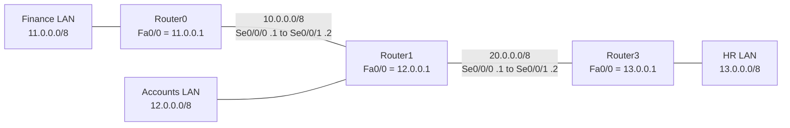

[← Back to all labs](../README.md)

# Static Routing Between Three Routers: Finance, Accounts and HR (Cisco Packet Tracer)

Three routers connected in a line by two serial links, each router serving its own LAN. Static routes on every router give all three departments full connectivity without any routing protocol.

## 📋 At a Glance

| | |
|---|---|
| **Lab number** | 2 |
| **Level** | Beginner, CCNA |
| **Tools** | Cisco Packet Tracer, Cisco IOS CLI |
| **Devices** | 3 routers (2811), 3 switches (2960), 6 PCs |
| **Protocols / features** | IPv4 static routing (next-hop routes), serial WAN links (DCE/DTE), directly connected routes |
| **Network(s)** | LANs: 11.0.0.0/8, 12.0.0.0/8, 13.0.0.0/8. Serial links: 10.0.0.0/8, 20.0.0.0/8 |
| **Static routes configured** | 8 (3 on Router0, 2 on Router1, 3 on Router3) |
| **CCNA domains** | Network Fundamentals, IP Connectivity |

## 📌 Project Objective

Connect three departmental networks (Finance, Accounts and HR) through three routers using only **static routes**, so that every network can reach every other network. Success means each router's routing table holds a route to all five networks in the topology: its own directly connected networks plus static routes for the rest.

## 🌍 Real-World Scenario

A company with three offices or departments, each behind its own router, links them over point-to-point WAN circuits. Static routing is still used in small networks, at the edge of a network (a stub site with one exit), and for predictable backup paths, because it adds no protocol traffic and is easy to reason about. Its limit is that every change must be made by hand on every router, which is why larger networks use OSPF or EIGRP.

## 🖧 Topology


Three LANs in a row. Each LAN has one router, one switch and two PCs. Router0 (Finance) connects to Router1 (Accounts) over the 10.0.0.0/8 serial link. Router1 connects to Router3 (HR) over the 20.0.0.0/8 serial link. Router1 sits in the middle and is the only router with three active interfaces.



The clock icons in the topology mark the **DCE** ends of the serial links: Se0/0/0 on Router0 and Se0/0/0 on Router1.

### Cabling

| From | Port | To | Port | Cable type |
|---|---|---|---|---|
| Router0 | Se0/0/0 | Router1 | Se0/0/1 | Serial (DCE on Router0 side) |
| Router1 | Se0/0/0 | Router3 | Se0/0/1 | Serial (DCE on Router1 side) |
| Router0 | Fa0/0 | Finance switch | Fa0/1 | Straight-through copper |
| Router1 | Fa0/0 | Accounts switch | Fa0/1 | Straight-through copper |
| Router3 | Fa0/0 | HR switch | Fa0/1 | Straight-through copper |
| Finance switch | Fa0/2 | PC 11.0.0.2 | Fa0 | Straight-through copper |
| Finance switch | Fa0/3 | PC 11.0.0.3 | Fa0 | Straight-through copper |
| Accounts switch | Fa0/2 | PC 12.0.0.2 | Fa0 | Straight-through copper |
| Accounts switch | Fa0/3 | PC 12.0.0.3 | Fa0 | Straight-through copper |
| HR switch | Fa0/2 | PC 13.0.0.2 | Fa0 | Straight-through copper |
| HR switch | Fa0/3 | PC 13.0.0.3 | Fa0 | Straight-through copper |

Router-to-switch and switch-to-PC links join unlike devices, so they use straight-through cables (the solid black lines in the topology).

### Addressing Table

| Device | Interface | IP Address | Subnet Mask | Prefix | Default Gateway |
|---|---|---|---|---|---|
| Router0 (Finance) | Fa0/0 | 11.0.0.1 | 255.0.0.0 | /8 | n/a |
| Router0 (Finance) | Se0/0/0 | 10.0.0.1 | 255.0.0.0 | /8 | n/a |
| Router1 (Accounts) | Fa0/0 | 12.0.0.1 | 255.0.0.0 | /8 | n/a |
| Router1 (Accounts) | Se0/0/1 | 10.0.0.2 | 255.0.0.0 | /8 | n/a |
| Router1 (Accounts) | Se0/0/0 | 20.0.0.1 | 255.0.0.0 | /8 | n/a |
| Router3 (HR) | Fa0/0 | 13.0.0.1 | 255.0.0.0 | /8 | n/a |
| Router3 (HR) | Se0/0/1 | 20.0.0.2 | 255.0.0.0 | /8 | n/a |
| Finance PC 1 | Fa0 | 11.0.0.2 | 255.0.0.0 | /8 | 11.0.0.1 |
| Finance PC 2 | Fa0 | 11.0.0.3 | 255.0.0.0 | /8 | 11.0.0.1 |
| Accounts PC 1 | Fa0 | 12.0.0.2 | 255.0.0.0 | /8 | 12.0.0.1 |
| Accounts PC 2 | Fa0 | 12.0.0.3 | 255.0.0.0 | /8 | 12.0.0.1 |
| HR PC 1 | Fa0 | 13.0.0.2 | 255.0.0.0 | /8 | 13.0.0.1 |
| HR PC 2 | Fa0 | 13.0.0.3 | 255.0.0.0 | /8 | 13.0.0.1 |

The router interface addresses, the PC addresses and the /8 masks of the router interfaces come from the topology and the routing-table screenshots. The PC mask and gateway values are the standard settings for this addressing (each PC's gateway is its own router's Fa0/0 address).

### Subnet Analysis

| Network | Mask | Network Address | First Usable | Last Usable | Broadcast | Usable Hosts | Private (RFC 1918)? |
|---|---|---|---|---|---|---|---|
| 10.0.0.0/8 (serial link 1) | 255.0.0.0 | 10.0.0.0 | 10.0.0.1 | 10.255.255.254 | 10.255.255.255 | 16,777,214 | Yes |
| 11.0.0.0/8 (Finance LAN) | 255.0.0.0 | 11.0.0.0 | 11.0.0.1 | 11.255.255.254 | 11.255.255.255 | 16,777,214 | No |
| 12.0.0.0/8 (Accounts LAN) | 255.0.0.0 | 12.0.0.0 | 12.0.0.1 | 12.255.255.254 | 12.255.255.255 | 16,777,214 | No |
| 13.0.0.0/8 (HR LAN) | 255.0.0.0 | 13.0.0.0 | 13.0.0.1 | 13.255.255.254 | 13.255.255.255 | 16,777,214 | No |
| 20.0.0.0/8 (serial link 2) | 255.0.0.0 | 20.0.0.0 | 20.0.0.1 | 20.255.255.254 | 20.255.255.255 | 16,777,214 | No |

- Every network is a Class A range with the default /8 mask, so each one could hold 2^24 − 2 = 16,777,214 hosts. That is far more than a two-PC LAN or a two-router serial link needs.
- Only 10.0.0.0/8 is private address space. The others are public ranges, which is acceptable in an isolated lab but would not be used this way on a real network.
- On each LAN the router takes the first address (.1) and the PCs start at .2. On each serial link the two ends are .1 and .2.

## 📚 Concepts Behind This Lab

### Static routing
A static route is typed in by the administrator: `ip route <network> <mask> <next-hop>`. It tells the router "to reach this network, send packets to that neighbor". It does not adapt if a link fails, but it uses no bandwidth or CPU for updates and is predictable. Static routes appear in the routing table with the code `S`.

### Routing must work in both directions
A ping needs a route to the destination **and** a route back for the reply. This is why every router here has a route to all five networks. If Router3 had no route to 11.0.0.0/8, a PC in Finance could send packets to HR but would never get a reply.

### Next-hop routes
Each static route here points to the **neighbor's IP address on the shared serial link** (for example, Router0 reaches 13.0.0.0/8 via 10.0.0.2). The router then does a second lookup to find which interface leads to that next hop. The next hop must be on a directly connected network, otherwise the route is not installed.

### Reading the routing table
- `C` is a directly connected network. `L` is the router's own address on that interface (a /32 host route). Both appear automatically once an interface is up/up with an IP address.
- `S 12.0.0.0/8 [1/0] via 10.0.0.2` means static route, **administrative distance 1**, **metric 0**, next hop 10.0.0.2.
- `is variably subnetted, 2 subnets, 2 masks` appears because each connected network has two entries with different masks (the /8 network and the /32 local address). It does not mean the lab uses VLSM.
- `Gateway of last resort is not set` means there is no default route. This lab uses specific routes only.

### Administrative distance
When two sources offer a route to the same network, the lower AD wins. Connected is 0, static is 1, EIGRP is 90, OSPF is 110, RIP is 120. A static route beats any dynamic protocol unless its AD is raised on purpose (a floating static route).

### Serial links, DCE and DTE
On a serial link one end is the DCE and supplies the clock signal with `clock rate`; the other end is the DTE. Without a clock the line protocol stays down. In Packet Tracer the clock icon on the topology marks the DCE end.

| | Static routing | Dynamic routing (RIP, OSPF, EIGRP) |
|---|---|---|
| Configured by | Administrator, per route | Protocol, automatically |
| Reacts to link failure | No | Yes |
| Router CPU and bandwidth cost | None | Some |
| Best for | Small networks, stub sites, backup paths | Larger or changing networks |

## 🧭 Lab Steps

1. Build the topology: three routers, three switches and six PCs, connected as shown in the cabling table.
2. Assign IP addresses to the router interfaces and bring them up with `no shutdown`. Set the clock rate on the DCE serial ends.
3. Set the IP address of each PC and use the Fa0/0 address of its router as the default gateway.
4. On Router0, add static routes to 12.0.0.0/8, 13.0.0.0/8 and 20.0.0.0/8 via 10.0.0.2.
5. On Router1, add static routes to 11.0.0.0/8 via 10.0.0.1 and to 13.0.0.0/8 via 20.0.0.2.
6. On Router3, add static routes to 10.0.0.0/8, 11.0.0.0/8 and 12.0.0.0/8 via 20.0.0.1.
7. Run `show ip route` on each router to confirm the connected and static routes.
8. Test end-to-end connectivity between PCs in different departments.

## ⚙️ Configuration

### Step 1: Topology and cabling


The topology image shows every router interface address and every PC address, which are the source of the addressing table above.

### Step 2: Interface addressing

The commands below are the standard way to produce the addresses shown in the topology and the connected routes (`C` and `L`) in the screenshots. The routing-table screenshots prove the result; the typing itself is not in the screenshots, so this block is reconstructed.

**Router0 (Finance)**
```
enable
configure terminal
interface fastEthernet 0/0
 ip address 11.0.0.1 255.0.0.0
 no shutdown
 exit
interface serial 0/0/0
 ip address 10.0.0.1 255.0.0.0
 clock rate 64000
 no shutdown
 end
```

**Router1 (Accounts)**
```
enable
configure terminal
interface fastEthernet 0/0
 ip address 12.0.0.1 255.0.0.0
 no shutdown
 exit
interface serial 0/0/1
 ip address 10.0.0.2 255.0.0.0
 no shutdown
 exit
interface serial 0/0/0
 ip address 20.0.0.1 255.0.0.0
 clock rate 64000
 no shutdown
 end
```

**Router3 (HR)**
```
enable
configure terminal
interface fastEthernet 0/0
 ip address 13.0.0.1 255.0.0.0
 no shutdown
 exit
interface serial 0/0/1
 ip address 20.0.0.2 255.0.0.0
 no shutdown
 end
```

| Command | Mode | What it does |
|---|---|---|
| `enable` | User EXEC → Privileged EXEC | Enters privileged mode (prompt changes from `>` to `#`). |
| `configure terminal` | Privileged EXEC | Enters global configuration mode (`Router(config)#`). |
| `interface fastEthernet 0/0` | Global config | Selects the LAN-facing interface (`Router(config-if)#`). |
| `ip address 11.0.0.1 255.0.0.0` | Interface config | Assigns the IPv4 address and mask. |
| `clock rate 64000` | Interface config (serial, DCE end only) | Supplies the clock for the serial link. |
| `no shutdown` | Interface config | Turns the interface on. Router interfaces are shut down by default. |
| `exit` / `end` | Interface config | `exit` goes back one level; `end` returns to Privileged EXEC. |

**Notes:** The clock rate value is not visible in the screenshots; 64000 is the common lab value and is shown as an example. The command is accepted only on the DCE end, which is the end with the clock icon in the topology. A connected route for a serial interface only appears in the routing table when the interface is up/up, so the `C` entries for Serial0/0/0 and Serial0/0/1 in the screenshots show those links came up.

### Step 3: Static routes

Each route uses the neighbor's address as the next hop (the `via` address in the screenshots). The `show ip route` output proves these routes exist; the typed commands are reconstructed from it.

**Router0**
```
configure terminal
ip route 12.0.0.0 255.0.0.0 10.0.0.2
ip route 13.0.0.0 255.0.0.0 10.0.0.2
ip route 20.0.0.0 255.0.0.0 10.0.0.2
end
```

**Router1**
```
configure terminal
ip route 11.0.0.0 255.0.0.0 10.0.0.1
ip route 13.0.0.0 255.0.0.0 20.0.0.2
end
```

**Router3**
```
configure terminal
ip route 10.0.0.0 255.0.0.0 20.0.0.1
ip route 11.0.0.0 255.0.0.0 20.0.0.1
ip route 12.0.0.0 255.0.0.0 20.0.0.1
end
```

| Command | Mode | What it does |
|---|---|---|
| `ip route 12.0.0.0 255.0.0.0 10.0.0.2` | Global config | Sends traffic for 12.0.0.0/8 to the next hop 10.0.0.2. Static routes have AD 1 by default. |

**Notes:** Router0 and Router3 each need three routes because they are at the ends of the chain and everything else lies beyond their one neighbor. Router1 only needs two, because the other two LANs and both links are directly connected or each lie behind exactly one neighbor.

| Network | Router0 | Router1 | Router3 |
|---|---|---|---|
| 10.0.0.0/8 | Connected (Se0/0/0) | Connected (Se0/0/1) | Static via 20.0.0.1 |
| 11.0.0.0/8 | Connected (Fa0/0) | Static via 10.0.0.1 | Static via 20.0.0.1 |
| 12.0.0.0/8 | Static via 10.0.0.2 | Connected (Fa0/0) | Static via 20.0.0.1 |
| 13.0.0.0/8 | Static via 10.0.0.2 | Static via 20.0.0.2 | Connected (Fa0/0) |
| 20.0.0.0/8 | Static via 10.0.0.2 | Connected (Se0/0/0) | Connected (Se0/0/1) |

Every router has a route to all five networks: 7 connected routes and 8 static routes, 15 in total (3 routers × 5 networks).

### Step 4: Check each routing table

Commands typed (from the screenshots):

```
Router>enable
Router#configure terminal
Router(config)#do show ip route
```

| Command | Mode | What it does |
|---|---|---|
| `do show ip route` | Global config | Runs the privileged EXEC command `show ip route` without leaving config mode. |

**Router0 (Finance)**


```
Gateway of last resort is not set

     10.0.0.0/8 is variably subnetted, 2 subnets, 2 masks
C       10.0.0.0/8 is directly connected, Serial0/0/0
L       10.0.0.1/32 is directly connected, Serial0/0/0
     11.0.0.0/8 is variably subnetted, 2 subnets, 2 masks
C       11.0.0.0/8 is directly connected, FastEthernet0/0
L       11.0.0.1/32 is directly connected, FastEthernet0/0
S    12.0.0.0/8 [1/0] via 10.0.0.2
S    13.0.0.0/8 [1/0] via 10.0.0.2
S    20.0.0.0/8 [1/0] via 10.0.0.2
```

**Router1 (Accounts)**


```
Gateway of last resort is not set

     10.0.0.0/8 is variably subnetted, 2 subnets, 2 masks
C       10.0.0.0/8 is directly connected, Serial0/0/1
L       10.0.0.2/32 is directly connected, Serial0/0/1
S    11.0.0.0/8 [1/0] via 10.0.0.1
     12.0.0.0/8 is variably subnetted, 2 subnets, 2 masks
C       12.0.0.0/8 is directly connected, FastEthernet0/0
L       12.0.0.1/32 is directly connected, FastEthernet0/0
S    13.0.0.0/8 [1/0] via 20.0.0.2
     20.0.0.0/8 is variably subnetted, 2 subnets, 2 masks
C       20.0.0.0/8 is directly connected, Serial0/0/0
L       20.0.0.1/32 is directly connected, Serial0/0/0
```

**Router3 (HR)**


```
Gateway of last resort is not set

S    10.0.0.0/8 [1/0] via 20.0.0.1
S    11.0.0.0/8 [1/0] via 20.0.0.1
S    12.0.0.0/8 [1/0] via 20.0.0.1
     13.0.0.0/8 is variably subnetted, 2 subnets, 2 masks
C       13.0.0.0/8 is directly connected, FastEthernet0/0
L       13.0.0.1/32 is directly connected, FastEthernet0/0
     20.0.0.0/8 is variably subnetted, 2 subnets, 2 masks
C       20.0.0.0/8 is directly connected, Serial0/0/1
L       20.0.0.2/32 is directly connected, Serial0/0/1
```

**Notes:** The legend lines (the code list at the top of the output) are left out of the transcriptions above. The device prompts still show the default hostname `Router` on all three routers, which is why the screenshots look alike; the title bar of each window (Router0, Router1, Router3) tells them apart.

## ✅ Verification & Results

| Check | Command / Action | What success looks like | Result |
|---|---|---|---|
| Connected networks are present | `show ip route` on each router | `C` and `L` entries for each active interface | Shown in screenshot |
| Static routes are installed | `show ip route` on each router | `S` entries with `[1/0]` and the correct next hop | Shown in screenshot |
| Every router knows all 5 networks | Compare the three tables (matrix in Step 3) | 5 networks listed on each router | Shown in screenshot |
| No default route in use | `show ip route` | `Gateway of last resort is not set` | Shown in screenshot |
| Interfaces are up/up | `show ip interface brief` | Status `up`, Protocol `up` on every used interface | Expected (not captured). Supported indirectly by the `C` routes. |
| PC to PC across one link | `ping 12.0.0.2` from 11.0.0.2 | Replies from 12.0.0.2 | Expected (not captured) |
| PC to PC across both links | `ping 13.0.0.2` from 11.0.0.2 | Replies from 13.0.0.2 | Expected (not captured) |
| Path taken | `tracert 13.0.0.2` from 11.0.0.2 | Three router hops, then the destination | Expected (not captured) |

**Expected path for `tracert 13.0.0.2` from PC 11.0.0.2** (derived from the routing tables above, not captured output):

| Hop | Device | Address expected in the reply |
|---|---|---|
| 1 | Router0 | 11.0.0.1 |
| 2 | Router1 | 10.0.0.2 |
| 3 | Router3 | 20.0.0.2 |
| 4 | HR PC | 13.0.0.2 |

**How a packet travels (walk-through based on the routing tables)**

1. PC 11.0.0.2 sees that 13.0.0.2 is not in its own 11.0.0.0/8 network, so it sends the packet to its gateway 11.0.0.1.
2. Router0 matches 13.0.0.0/8 (`S`, via 10.0.0.2) and sends it out Se0/0/0.
3. Router1 receives it on Se0/0/1, matches 13.0.0.0/8 (`S`, via 20.0.0.2) and sends it out Se0/0/0.
4. Router3 receives it on Se0/0/1, matches 13.0.0.0/8 (`C`, FastEthernet0/0) and delivers it to the PC.
5. The reply returns the same way: Router3 uses 11.0.0.0/8 via 20.0.0.1, Router1 uses 11.0.0.0/8 via 10.0.0.1, and Router0 delivers it on its connected Fa0/0.

## 🛠️ Troubleshooting Notes

No problems were reported for this lab. The table below is **general guidance** for static routing labs of this type, not a record of issues hit here.

| Symptom | Likely cause | How to check | Fix |
|---|---|---|---|
| Ping works inside a LAN but not to another LAN | PC has no or a wrong default gateway or mask | `ipconfig /all` on the PC | Set gateway to the router's Fa0/0 address |
| Ping goes out but no reply returns | Missing return route on one of the routers | `show ip route` on every router along the path | Add the missing static route |
| `Destination host unreachable` from a router | That router has no route to the destination | `show ip route` on the router that replies | Add the route |
| Serial interface is down or up/down | Missing `clock rate` on the DCE end, or `no shutdown` missing | `show ip interface brief`, `show controllers serial 0/0/0` | Add `clock rate` on the DCE side, then `no shutdown` |
| Static route missing from the table | Next hop is not on a connected network, or the interface to it is down | `show ip interface brief` | Fix the link or the next-hop address |
| Static route shows the wrong next hop | Typo in the `ip route` command | `show running-config \| include ip route` | `no ip route ...` the wrong line, add the correct one |
| First ping times out, later ones succeed | ARP is resolving (normal) | Run the ping again | None needed |

General method: check Layer 1 (cables, interface status), then Layer 3 (IP, mask, gateway), then routes on each router in the path, one hop at a time.

## 💼 Skills Demonstrated

- Designed and documented an IPv4 addressing plan for three LANs and two point-to-point links.
- Configured IPv4 static routes using next-hop addresses on three Cisco routers.
- Built the topology with correct cable types: serial DCE/DTE links and straight-through copper.
- Read and interpreted routing tables, including `C`, `L` and `S` entries, administrative distance and metric.
- Planned routes in both directions so replies have a path back to the sender.
- Verified configurations using `show ip route` on each device.

**CCNA 200-301 mapping:** 1.0 Network Fundamentals (IPv4 addressing, cable and interface types); 3.0 IP Connectivity (interpret the components of a routing table, how a router makes a forwarding decision, configure and verify IPv4 static routing).

## 📂 Files in This Lab

```
Lab-2/
├── README.md
├── static_routing.pkt              # Packet Tracer lab file
├── Static_routing_topology.JPG     # Topology with all IP addresses
├── R1_IP_route.JPG                 # show ip route on Router0 (Finance)
├── R2_IP_route.JPG                 # show ip route on Router1 (Accounts)
└── R3_IP_route.JPG                 # show ip route on Router3 (HR)
```

## 🚀 How to Open This Lab

1. Install [Cisco Packet Tracer](https://www.netacad.com/courses/packet-tracer) (free with a Cisco NetAcad account).
2. Open `static_routing.pkt`.
3. Click a router, open the **CLI** tab, press Enter, then type `enable` and `show ip route` to see its table.
4. Click a PC, open **Desktop → Command Prompt**, and run `ping 13.0.0.2` from a Finance PC (or `tracert 13.0.0.2`) to test the full path.

## 🔭 Possible Improvements

- Replace the three routes on Router0 and Router3 with a single **default route** (`ip route 0.0.0.0 0.0.0.0 <next hop>`), since both are stub routers with only one exit.
- Use smaller, more realistic subnets: private ranges such as 192.168.x.0/24 for the LANs and /30 for the serial links.
- Add a **floating static route** over a second link, with a higher administrative distance, to practice backup paths.
- Set router hostnames, passwords and SSH, then save with `copy running-config startup-config`.
- Repeat the lab with RIP or OSPF and compare the routing tables with this one.

## 👤 Author

[Your Name] — Aspiring Network Engineer, building CCNA / networking fundamentals skills.

---
*This lab is part of my ongoing CCNA / Network Administrator study roadmap.*
